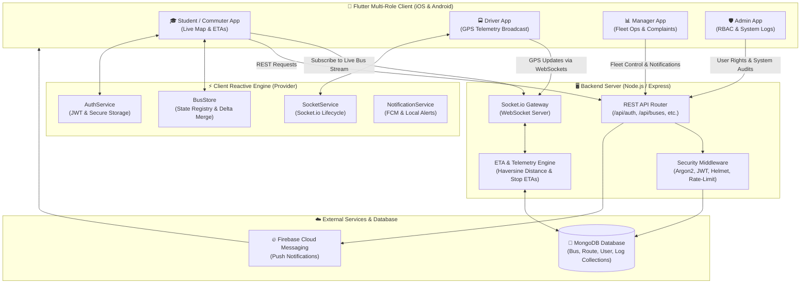
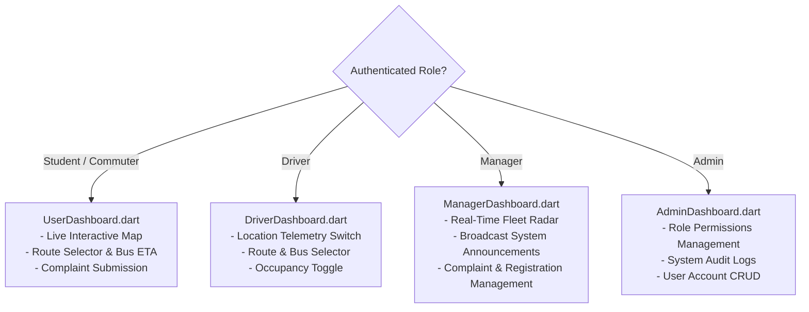
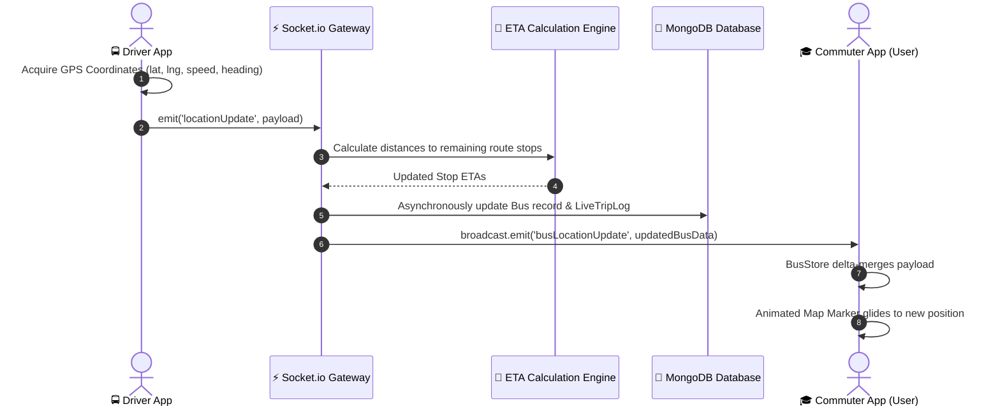

# 🏗️ SISTec Chalo - System Architecture Documentation

**SISTec Chalo** (also known as SmartCampus Shuttle / Bus Tracking System) is a multi-role, real-time campus shuttle tracking ecosystem built on a **Hybrid Client-Server Architecture**. It decouples static CRUD operations and authentication (handled via REST HTTP APIs) from real-time vehicle telemetry and alerts (handled via low-latency WebSockets).

---

## 🏛️ High-Level System Architecture



---

## 🛠️ Technology Stack

| Layer | Technology / Package | Purpose |
| :--- | :--- | :--- |
| **Frontend Framework** | **Flutter** (Dart `>=3.4.0`) | Cross-platform UI for Android & iOS |
| **Client State Management** | `provider` (`^6.1.2`) | Reactive dependency injection & state management |
| **Real-Time Gateway (Client)**| `socket_io_client` (`^2.0.3`) | WebSocket connection management |
| **Map Rendering Engine** | `google_maps_flutter` (`^2.7.0`) | Native Google Maps vector rendering, custom dark map styling, dynamic polylines & animated bus markers |
| **Local Storage & Security** | `flutter_secure_storage` | Encrypted JWT token persistence |
| **Push Notifications** | `firebase_messaging` & `flutter_local_notifications` | Background & foreground system notifications |
| **Backend Core** | **Node.js** with **Express.js** | HTTP REST server & WebSocket orchestrator |
| **Database & ORM** | **MongoDB** with **Mongoose** | Document store for routes, buses, users, logs, and complaints |
| **Real-Time Gateway (Server)**| **Socket.io** | High-concurrency bidirectional WebSocket broadcasting |
| **Security & Hashing** | `argon2`, `jsonwebtoken`, `helmet`, `express-rate-limit` | Password hashing, JWT verification, header security, brute-force protection |

---

## 📱 Client-Side Architecture (Flutter)

The mobile client (`/lib`) enforces clean separation of concerns:

```
lib/
├── components/          # Reusable UI widgets (cards, glass containers, map controls)
├── constants/           # Colors, Theme tokens, API endpoint definitions
├── models/              # Data structures (bus_model.dart, route_model.dart, user_model.dart)
├── screens/             # Role-based dashboards & administrative views
├── services/            # Core business logic & state providers
│   ├── api_service.dart          # HTTP REST API calls
│   ├── auth_service.dart         # Authentication & RBAC token state
│   ├── bus_store.dart            # Live telemetry registry & delta merging
│   ├── notification_service.dart # Push notification handler
│   └── socket_service.dart       # WebSocket event broker
├── theme/               # Dark Space glassmorphism design tokens
└── main.dart            # MultiProvider initialization & entry point
```

### 1. Core State Services

* **`AuthService`** (`lib/services/auth_service.dart`): Manages authentication lifecycle, JWT token persistence using `flutter_secure_storage`, login/logout states, and active user roles (`student`, `driver`, `manager`, `admin`).
* **`SocketService`** (`lib/services/socket_service.dart`): Controls the `Socket.io` connection lifecycle. Handles auto-reconnection with backoff, token injection, and dispatches incoming WebSocket frames.
* **`BusStore`** (`lib/services/bus_store.dart`): The central real-time state repository:
  * **Incremental Delta Merging**: Merges location updates directly into `Map<String, Bus>` to eliminate full-list re-renders and map flickering.
  * **Stale Purging**: Automatically purges buses that have not broadcasted location updates for >120 seconds.
  * **Geofencing Stream**: Emits approach events when a bus is near a commuter's selected stop.
* **`NotificationService`** (`lib/services/notification_service.dart`): Integrates Firebase Messaging (FCM) for background alerts and triggers local notifications.

---

### 2. Role-Based Presentation Layer

The UI adapts dynamically depending on the authenticated user's role:



---

## 🖥️ Backend Architecture (Node.js & Express)

The backend (`/backend`) serves as both the **REST API Provider** and the **WebSocket Real-time Broadcast Relay**.

```
backend/
├── middleware/
│   └── authMiddleware.js       # JWT validation & RBAC authorization
├── models/                     # Mongoose Schemas
│   ├── Admin.js
│   ├── Alert.js
│   ├── Bus.js
│   ├── Complaint.js
│   ├── Driver.js
│   ├── LiveTripLog.js
│   ├── Manager.js
│   ├── Notification.js
│   ├── RegistrationForm.js
│   ├── Route.js
│   ├── Schedule.js
│   └── Student.js
├── geocode_stops.js            # Geofencing & coordinate utilities
├── seed_real_routes.js         # Route pre-seeding scripts
└── server.js                   # Main application entry point
```

### Key Server Components

1. **Security & Auth Layer**:
   * Passwords hashed using **Argon2**.
   * Protected routes validated via `authMiddleware.js` checking Bearer JWTs.
   * Rate limiting and `Helmet` security headers enabled.

2. **Real-time Telemetry & ETA Engine**:
   * Listens for `locationUpdate` frames from Driver clients via `Socket.io`.
   * Calculates dynamic arrival times (ETAs) for upcoming route stops using the **Haversine Formula** (spherical distance & current vehicle velocity).
   * Persists coordinates (`currentLat`, `currentLng`, `speed`, `heading`, `status`) to MongoDB.
   * Immediately broadcasts the updated telemetry to all listening Commuter & Manager clients via `socket.broadcast.emit('busLocationUpdate', data)`.

---

## 🔄 Real-Time Location Telemetry Pipeline



---

## 🎨 Design System & Aesthetics

* **Theme**: Modern Deep Space Glassmorphism (`AppColors.bg = #0F1528`).
* **Micro-animations**: Smooth tile polyline loading, shimmer placeholders (`shimmer`), smooth marker interpolation (`flutter_animate`).
* **Cross-Platform Compatibility**: Fully adaptive to Web, Android, and iOS viewport sizes.
