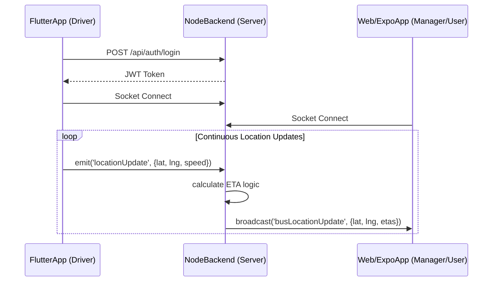

# Sistec Chalo - Architecture Overview

The system consists of three distinct components communicating over REST APIs and WebSockets.

## 1. Node.js Backend

- Runs the core server logic, including user authentication, CRUD operations for students/managers, and real-time Socket.io coordination.
- **Data Store**: MongoDB. Stores route information, user credentials (hashed via Argon2), and the latest snapshot of each bus's status.
- **Port:** Defaults to 5000.

## 2. React Native (Expo) - Manager & Admin App

- Target Audience: Transport Administrators, Route Managers, and standard users viewing map tracking.
- **Primary Function**: To visually map buses, assign drivers/routes, add students, and broadcast notifications.
- **Connection**: It connects to the Socket.io server to listen to incoming `busLocationUpdate` and `notification` events, rendering them lively on the interactive map.

## 3. Flutter App - Tracking Node

- Target Audience: Bus Drivers.
- **Primary Function**: To sample background GPS coordinates using the device's hardware and broadcast the location and speed to the Node.js backend continuously using a Socket.io event (`locationUpdate`).
- **Connection**: It acts as the primary data publisher for real-time map positions.

## Communication Flow

